# SK Flow — Central Inteligente de Ocorrências

> Aplicação web low-code em **OutSystems Developer Cloud (ODC)** para registrar, classificar e acompanhar ocorrências de trabalhadores estrangeiros, com **IA multilíngue**, **prazos SLA em horas úteis** e **indicadores gerenciais**.

Projeto acadêmico da disciplina **Desenvolvimento de Aplicações Web Low Code** — Graduação Tecnológica em Inteligência Artificial e Automação Digital (UniFECAF).

> ⚠️ **Ambiente acadêmico.** Todos os trabalhadores, empresas, telefones e mensagens são **fictícios**. Nenhum dado real é utilizado.

---

## Sumário

1. [O problema](#1-o-problema)
2. [A solução](#2-a-solução)
3. [Funcionalidades](#3-funcionalidades)
4. [Inteligência Artificial](#4-inteligência-artificial)
5. [Arquitetura (Canvas)](#5-arquitetura-canvas)
6. [Modelo de dados](#6-modelo-de-dados)
7. [Regras de negócio e workflow](#7-regras-de-negócio-e-workflow)
8. [Tecnologias](#8-tecnologias)
9. [Acessibilidade, dados e uso responsável](#9-acessibilidade-dados-e-uso-responsável)
10. [Prints](#10-prints)
11. [Como testar](#11-como-testar)
12. [Limitações e próximos passos](#12-limitações-e-próximos-passos)

---

## 1. O problema

A **SK Link** (Aichi, Japão) intermedeia a contratação de trabalhadores estrangeiros para empresas japonesas. Esses trabalhadores entram em contato com a equipe por **LINE, WhatsApp, telefone ou pessoalmente**, em **vários idiomas** — vietnamita, birmanês, português, espanhol e japonês — para tratar de holerite, visto, moradia, saúde, transporte e outros assuntos.

Hoje esse atendimento depende de mensagens espalhadas e controles manuais, o que causa:

- **barreira de idioma** — o atendente nem sempre entende a mensagem original;
- **falta de priorização** — um acidente de trabalho pode ficar na fila atrás de uma dúvida simples;
- **prazos sem controle** — não há registro de quando a solicitação vence;
- **nenhuma visão gerencial** — gestores não sabem quantas ocorrências estão atrasadas, de quais empresas ou em quais idiomas.

**Público:** atendentes da SK Link (uso diário) e gestores (acompanhamento por indicadores).

## 2. A solução

O **SK Flow** centraliza o ciclo de vida de cada ocorrência:

1. O atendente registra a mensagem recebida, **em qualquer idioma**.
2. A **IA** detecta o idioma, traduz para o português, resume e **sugere categoria e prioridade**.
3. O atendente **confirma ou corrige** a classificação (a decisão final é sempre humana).
4. O sistema calcula o **prazo SLA em horas úteis** (seg–sex, 9h–18h, horário do Japão).
5. A IA sugere uma **resposta ao trabalhador**, no idioma dele e em português para revisão.
6. A ocorrência avança no **workflow** (lista ou Kanban), com histórico completo.
7. O **Dashboard** mostra indicadores e ocorrências atrasadas em tempo real.

**Diferencial em relação a um simples "Fale Conosco":** o foco não é receber mensagens, e sim a **gestão operacional** — classificação multilíngue, prioridade, prazos em horas úteis, indicador de atraso e visão gerencial.

## 3. Funcionalidades

| Tela | O que faz |
|---|---|
| **Dashboard** | KPIs (em aberto, atrasadas agora, resolvidas no prazo, tempo médio de resolução, % de classificações da IA aceitas), gráficos por categoria, idioma e empresa cliente, e lista "Atrasadas agora". |
| **Ocorrências** | Busca e filtros (status, prioridade, idioma, categoria, só atrasadas). Visão **Lista** e **Kanban** com **arrastar e soltar** e botão acessível **"Mover para…"**. |
| **Nova ocorrência** | Seleção do trabalhador, canal de origem e mensagem original. Botão **"Registrar e analisar com IA"**. |
| **Detalhe** | Mensagem original + tradução, resumo, classificação sugerida pela IA (confirmar/corrigir), resposta sugerida nos dois idiomas, envio de resposta, troca de status, dados do trabalhador (telefone mascarado), prazo SLA, interações e histórico de status. |

Outros destaques:

- **Bandeiras por idioma** (🇯🇵 🇧🇷 🇻🇳 🇲🇲 🇪🇸) desenhadas em SVG no próprio app, com texto alternativo.
- **Layout responsivo**: no celular, tabelas viram cartões e o menu vira menu hambúrguer.
- **Identidade visual SK Link** (vermelho `#C80000`, logo, fonte Inter).

## 4. Inteligência Artificial

| Item | Decisão |
|---|---|
| Modelo | **OpenAI gpt-4o-mini**, conectado pelo recurso nativo **AI models** do ODC (conexão `openai_gpt4o_mini`). |
| Onde é chamada | Server actions `AnalisarMensagemIA` e `TraduzirTextoIA` no **SKFlow_Core**. |
| Entrada | **Somente o texto da mensagem** — nome, telefone e empresa do trabalhador não são enviados. |
| Saída (JSON) | `Idioma`, `Categoria`, `Prioridade`, `Resumo` (3ª pessoa), `Traducao`, `RespostaSugeridaOriginal` (idioma do trabalhador), `RespostaSugeridaTraducao` (português). |
| Parâmetros | `temperature` 0.2 na análise (respostas consistentes) e 0 na tradução. |
| Regras no prompt | Resposta sempre **da SK Link para o trabalhador**, sem prometer datas ou valores e sem inventar fatos; resposta no **mesmo idioma** da mensagem; resumo em 3ª pessoa ("O trabalhador relata que…"). |
| Controle humano | A IA **sugere**; o atendente **confirma ou corrige**. O sistema registra se houve correção (indicador "Classificação da IA aceita"). |
| Regra acima da IA | Se a categoria for **Saúde/Acidente**, a prioridade é **no mínimo Alta**, mesmo que a IA sugira menos. |
| Falha da IA | A ocorrência é criada mesmo assim, marcada como **"Classificação pendente"** para classificação manual. |

> **Decisão técnica registrada:** a primeira versão usava uma chamada REST manual à API da OpenAI. Caracteres não latinos (vietnamita, birmanês, japonês) chegavam corrompidos dentro da plataforma. A integração foi migrada para o conector nativo **AI models** do ODC, que resolveu o problema e manteve a API key fora do código (configurada apenas no Portal do ODC).

## 5. Arquitetura (Canvas)

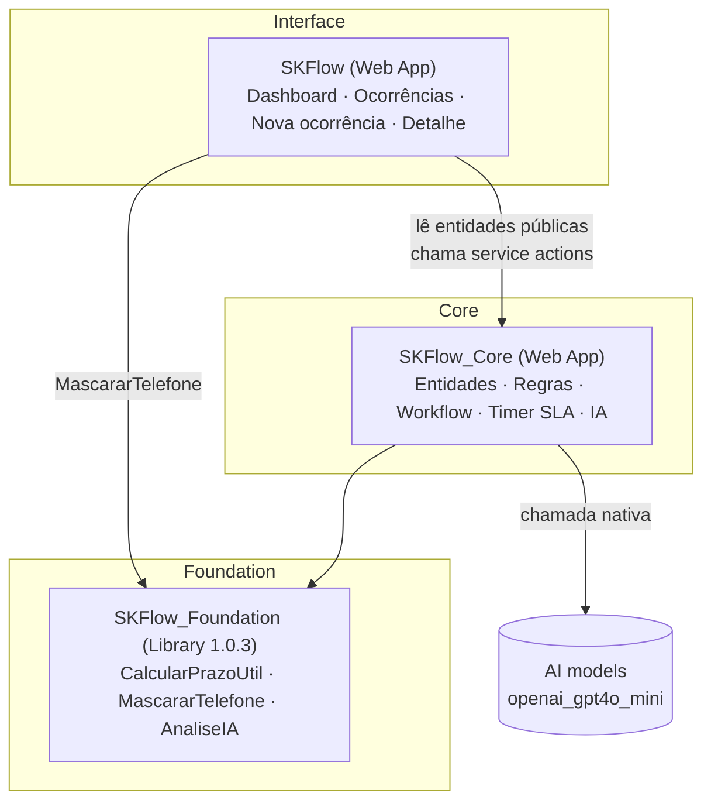

| Camada | Asset ODC | Responsabilidade |
|---|---|---|
| **Interface** | `SKFlow` (Web App) | Telas, tema, componentes visuais (badges, bandeiras, Kanban). **Não tem entidades nem regras de negócio**: lê dados do Core e grava apenas por service actions. |
| **Core** | `SKFlow_Core` (Web App) | Entidades, regras de negócio, workflow de status, timer de SLA, dados de demonstração e orquestração da IA. |
| **Foundation** | `SKFlow_Foundation` (Library) | Serviços reutilizáveis e sem regra de negócio: cálculo de prazo em horas úteis (com fuso do Japão), mascaramento de telefone e estrutura de dados da IA. |

> No ODC, **Libraries não podem ter entidades nem consumir o conector AI models**. Por isso entidades e chamadas à IA ficam no Core, e a Foundation mantém apenas utilitários.

## 6. Modelo de dados

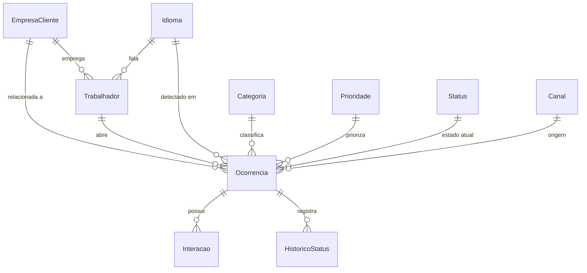

**Entidades:** `EmpresaCliente`, `Trabalhador`, `Ocorrencia`, `Interacao`, `HistoricoStatus`.

**Entidades estáticas:**

| Entidade | Valores |
|---|---|
| `Idioma` | ja Japonês · pt Português · vi Vietnamita · my Birmanês · es Espanhol |
| `Categoria` | Salário/Holerite · Visto/Documentos · Moradia · Saúde/Acidente · Transporte · Relação no trabalho · Outros |
| `Prioridade` (SLA em horas úteis) | Urgente 4h · Alta 24h · Média 27h (3 dias) · Baixa 63h (7 dias) |
| `Status` | Aberta · Em análise · Aguardando trabalhador · Resolvida |
| `Canal` | LINE · WhatsApp · Telefone · Presencial · E-mail |

Campos importantes de `Ocorrencia`: mensagem original, tradução, resumo, categoria/prioridade **sugeridas pela IA** e **finais**, `ClassificacaoConfirmada`, `ClassificacaoCorrigida`, `ClassificacaoPendente`, `DataAbertura`, `PrazoSLA`, `DataEstouroSLA`, `DataResolucao`, responsável.

## 7. Regras de negócio e workflow

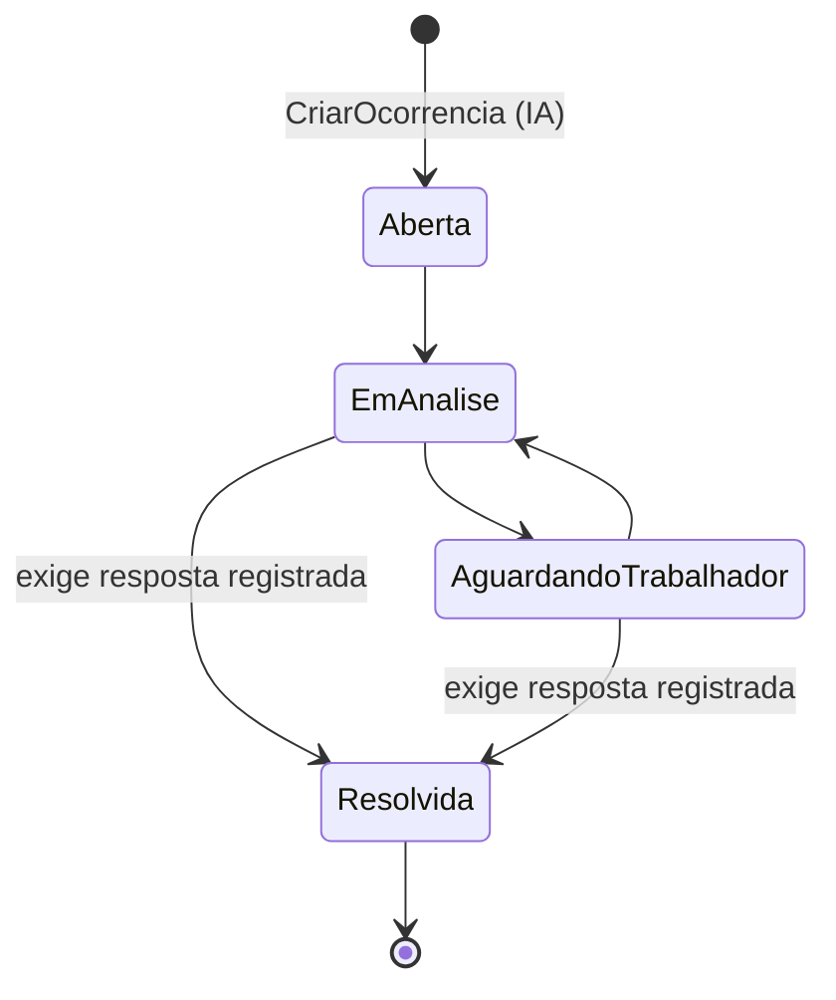

1. **SLA em horas úteis:** o prazo conta apenas seg–sex, 9h–18h, no **horário do Japão (UTC+9)**. Ex.: aberta quinta às 18:33 com prioridade Alta (24h úteis) → vence **terça às 15:00**.
2. **"Atrasada" é um indicador, não um status:** `Status ≠ Resolvida` e `agora > PrazoSLA`. Uma ocorrência pode estar *Em análise* **e** *Atrasada* ao mesmo tempo.
3. **Timer `VerificarSLA` (a cada hora):** grava `DataEstouroSLA` e registra no histórico "Indicador Atrasada ativado (status mantido)".
4. **Saúde/Acidente ≥ Alta**, independentemente da sugestão da IA.
5. **Resolvida só com resposta:** não é possível resolver sem ao menos uma resposta do atendente (vale para o botão, o arrastar no Kanban e o menu "Mover para…").
6. **Toda mudança de status gera histórico**, com usuário, data e observação.
7. **Correção da IA é registrada**, alimentando o indicador de aceitação da IA.

## 8. Tecnologias

| Tecnologia | Uso |
|---|---|
| **OutSystems Developer Cloud (ODC)** | Plataforma low-code: apps, library, banco de dados, timer, publicação. |
| **ODC AI models + OpenAI gpt-4o-mini** | Detecção de idioma, tradução, resumo, classificação e resposta sugerida. |
| **OutSystems Charts (Forge)** | Gráficos de barras do Dashboard. |
| **OutSystems UI** | Layout, padrões responsivos, componentes de formulário. |
| **HTML5 Drag and Drop + JavaScript** | Arrastar e soltar cartões no Kanban (sem bibliotecas externas). |
| **SVG inline** | Bandeiras dos idiomas. |
| **ODC Mentor** | Assistente de IA da plataforma, usado para acelerar a construção. |

## 9. Acessibilidade, dados e uso responsável

**Acessibilidade**

- Prioridade e atraso sempre indicados por **texto + cor**, nunca só por cor.
- Contraste mínimo **4.5:1**; alvos de toque com **44px**.
- **Alternativa ao arrastar e soltar:** botão "Mover para…" acessível por toque, teclado (Tab/Enter/Esc) e leitor de tela.
- Bandeiras com `aria-label` e nome do idioma visível (no celular, nome em tooltip/texto alternativo).
- Rótulos em todos os campos; layout responsivo para celular.

**Dados e privacidade**

- **Somente dados fictícios**, com aviso fixo na tela de cadastro.
- **Minimização:** apenas o texto da mensagem é enviado à IA — sem nome, telefone ou empresa.
- **Telefone mascarado** na interface (`090-****-**82`).
- **API key fora do código**, configurada apenas no Portal do ODC.
- Em uso real, seriam necessários consentimento do trabalhador, anonimização efetiva do texto, controle de acesso por papéis e contrato com o provedor de IA adequado à **LGPD** e à lei japonesa **APPI**.

**Uso responsável da IA**

- A IA é **assistente**, não decisora: o atendente revisa classificação e resposta antes de enviar.
- Regras críticas (Saúde/Acidente) ficam **na lógica de negócio**, não no modelo.
- Falha da IA não bloqueia o atendimento (classificação manual).
- Traduções em idiomas com menos recursos (ex.: birmanês) devem ser validadas por falantes nativos antes do uso real.

**Sustentabilidade digital**

- Modelo de IA de porte reduzido (`gpt-4o-mini`), chamado **uma vez por ocorrência** (e uma vez por resposta enviada).
- Sem bibliotecas externas para Kanban e bandeiras; imagens leves em SVG.

## 10. Prints

### Computador

| Dashboard | Atrasadas agora |
|---|---|
| 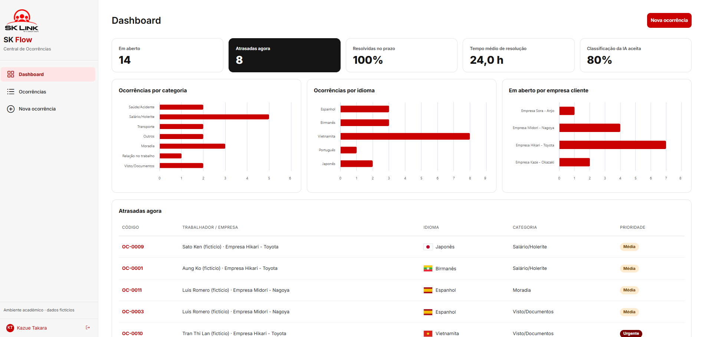 | 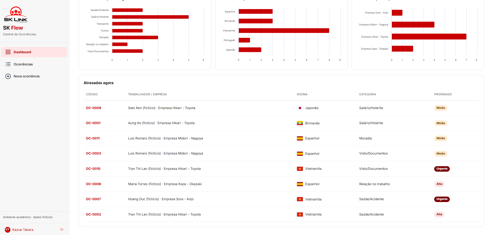 |

| Ocorrências — Lista | Ocorrências — Kanban |
|---|---|
| 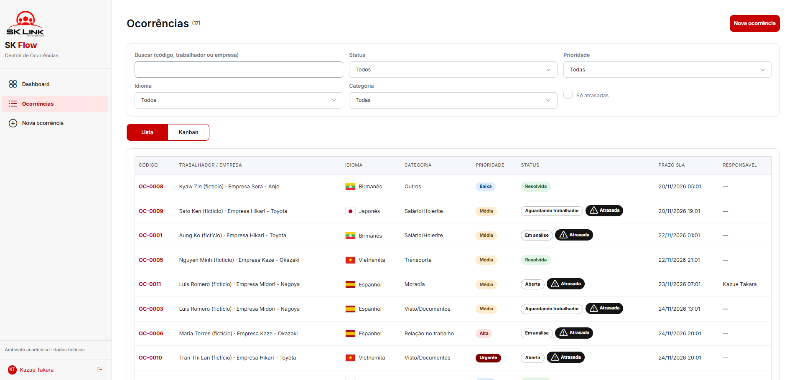 | 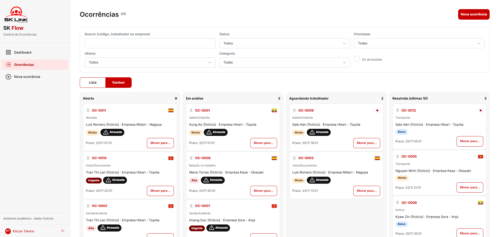 |

| Nova ocorrência (birmanês) | Detalhe — análise da IA |
|---|---|
| 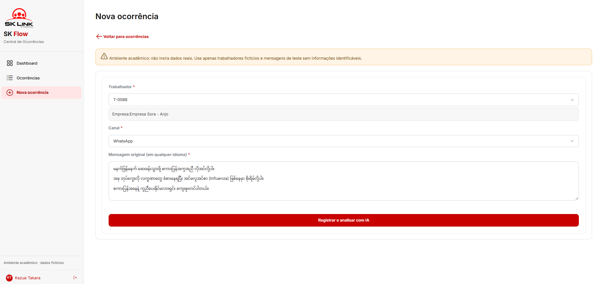 | 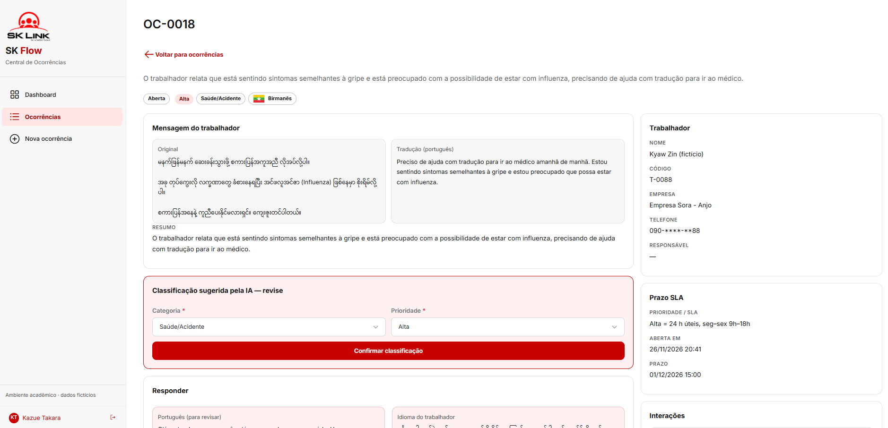 |

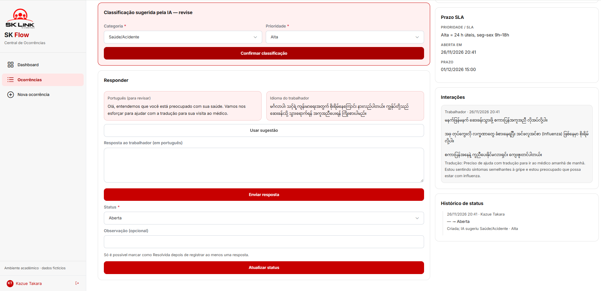

### Celular

| Dashboard | Gráficos | Atrasadas |
|---|---|---|
| 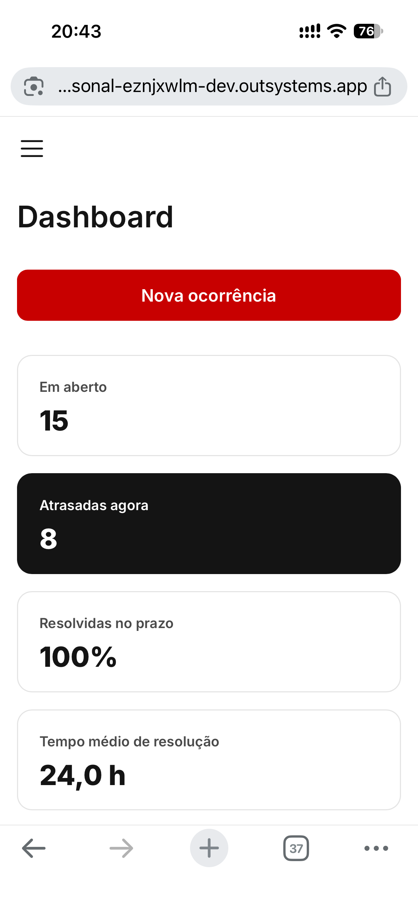 | 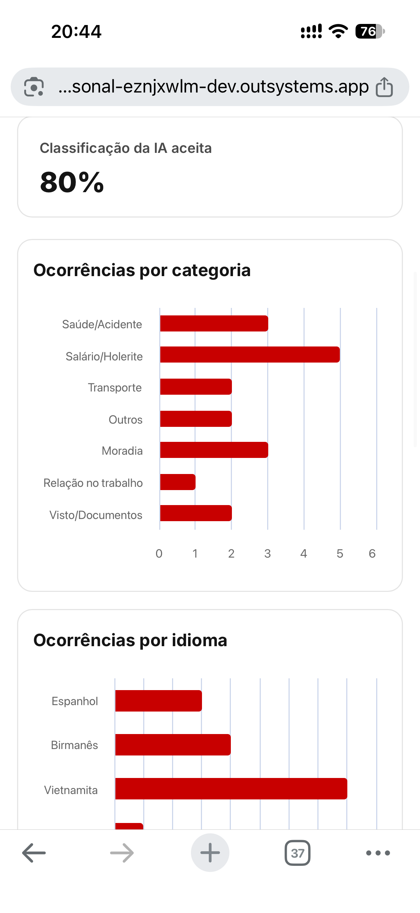 | 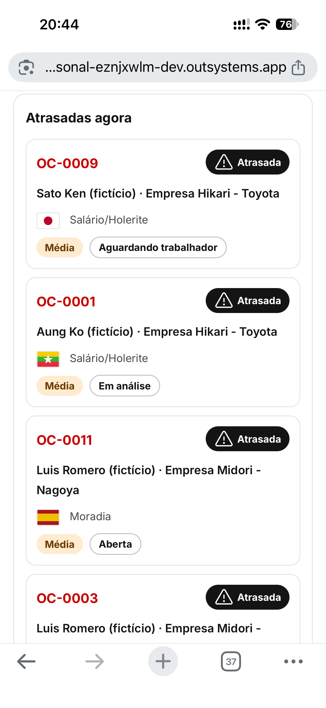 |

| Lista | Kanban | Mover para… |
|---|---|---|
| 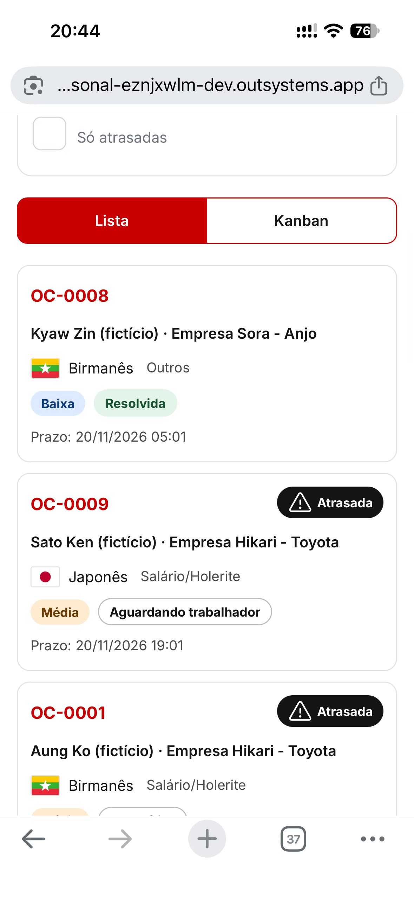 | 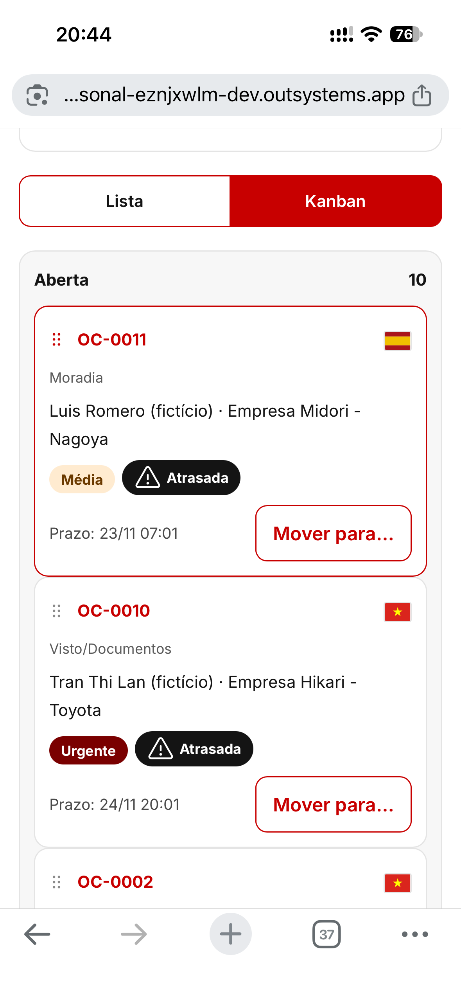 | 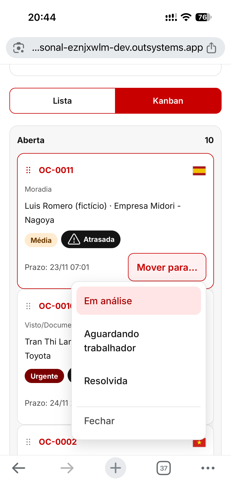 |

| Nova ocorrência (espanhol) | Detalhe | Resposta sugerida |
|---|---|---|
| 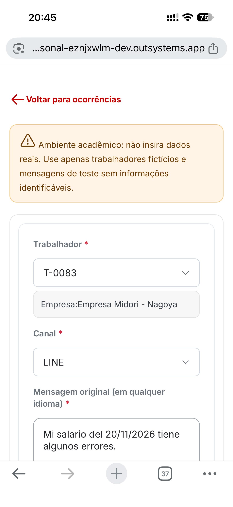 | 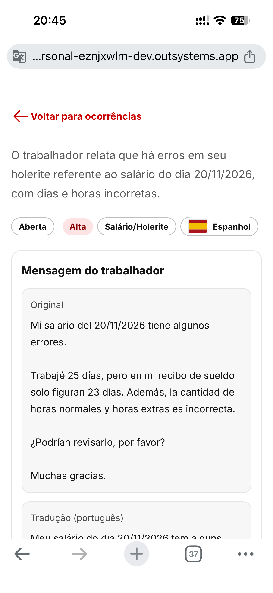 | 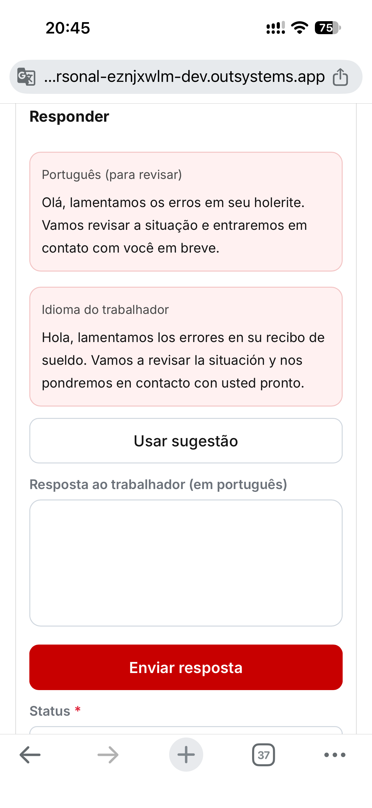 |

## 11. Como testar

**Aplicação:** https://personal-eznjxwlm-dev.outsystems.app/SKFlow

**Vídeo pitch:** _[inserir link do YouTube/Loom/Drive]_

1. **Acesso** — entre com o usuário de teste fornecido pelo autor. O usuário precisa ter o papel **SKFlow** (Portal ODC → Users → End-user access).
2. **Dados de demonstração** — se o Dashboard estiver vazio, clique em **"Carregar dados de demonstração"** (4 empresas, 9 trabalhadores e 12 ocorrências fictícias).
3. **Dashboard** — confira os indicadores, os gráficos e a lista de atrasadas.
4. **Nova ocorrência com IA** — escolha um trabalhador, um canal e cole uma das mensagens abaixo. Clique em **"Registrar e analisar com IA"**.

   | Idioma | Mensagem de teste | Esperado |
   |---|---|---|
   | Vietnamita | `Tháng này lương của tôi bị thiếu tiền làm thêm giờ. Tôi đã làm 20 giờ tăng ca nhưng phiếu lương chỉ ghi 12 giờ.` | Salário/Holerite |
   | Birmanês | `ကျွန်တော့်အခန်းက အပူပေးစက် ပျက်နေပါတယ်။ ညဘက် အရမ်းအေးလို့ အိပ်လို့မရပါဘူး။` | Moradia |
   | Espanhol | `Mi salario del 20/11/2026 tiene algunos errores. Trabajé 25 días, pero en mi recibo de sueldo solo figuran 23 días.` | Salário/Holerite |

5. **Detalhe** — confirme ou corrija a classificação, clique em **"Usar sugestão"**, envie a resposta e atualize o status.
6. **Regra de resolução** — tente marcar como *Resolvida* uma ocorrência **sem resposta**: o sistema bloqueia com mensagem de erro.
7. **Kanban** — em **Ocorrências → Kanban**, arraste um cartão para outra coluna (no PC) ou use **"Mover para…"** (no celular ou teclado). Veja o registro no histórico do Detalhe.
8. **Celular** — abra o mesmo link no celular para ver a versão responsiva.

## 12. Limitações e próximos passos

- **Feriados** não são considerados no cálculo de horas úteis (apenas noites e fins de semana).
- **Papéis** ainda não distinguem atendente e gestor.
- O "tempo médio de resolução" usa horas corridas; pode passar a usar horas úteis.
- Os prazos dos dados de demonstração usam horas corridas, apenas para ilustrar o indicador Atrasada.
- Próximos passos: integração real com LINE/WhatsApp, notificações por e-mail no estouro do SLA, perfis de acesso, relatórios exportáveis e revisão das traduções por falantes nativos.

---

**Autor:** Kazue Takara — UniFECAF, Graduação Tecnológica em Inteligência Artificial e Automação Digital
**Disciplina:** Desenvolvimento de Aplicações Web Low Code
